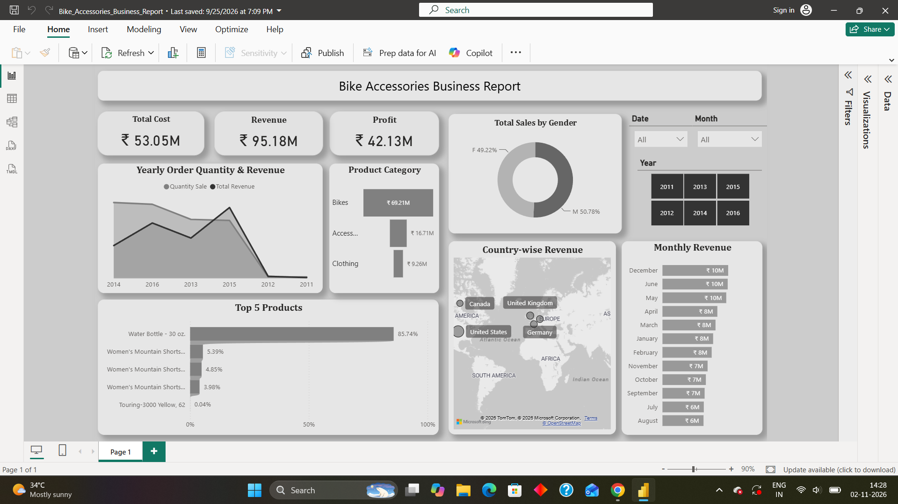

# Bike Accessories Business Report 
## Project Objectives :

Bike Accessories(2011 - 2016), Data Analyzed and Visualized in Power BI.

 
1. KPIS - Total Cost, Total Revenue, and Total Profit?
2. Yearly order quantity, total sales, and revenue?
3. Product categories generate the highest revenue?
5. Total sales by gender?
6. Top 5 best-selling products?
7.Countries generate the highest revenue?
 

Project link : <a href="https://github.com/gowsikan1021/Bike-Accessories-Business-Report/blob/cc981b03717205c500f187bc5a1db6989ea0c620/Bike_Accessories_Business_Report.pbix">
    Bike Accessories Business Report
  </a>

 
Dashboard :
 
 

 

""

